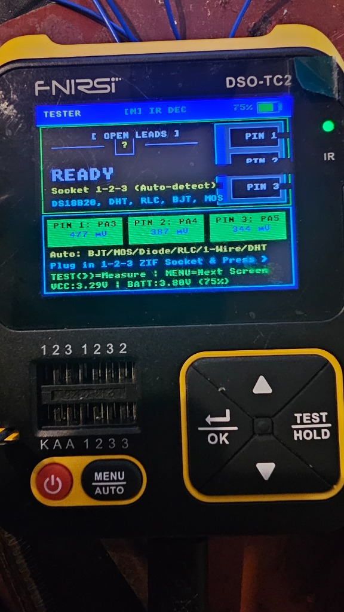
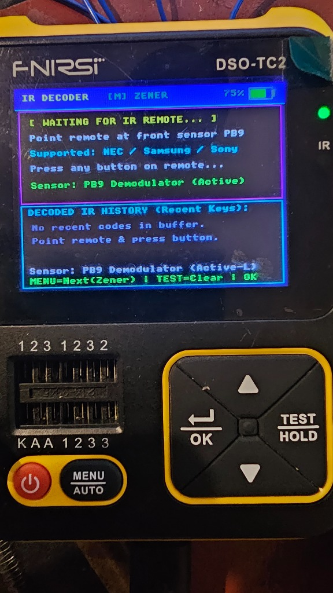
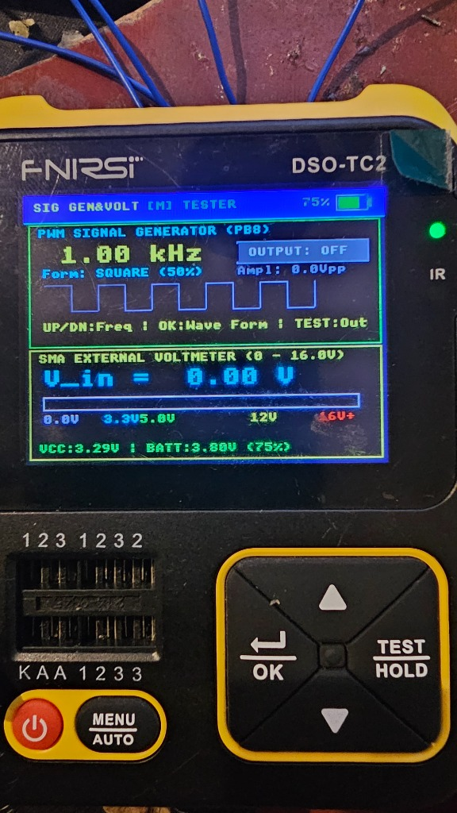

# FNIRSI DSO-TC2 High-Performance Custom ROM

[](https://platformio.org/)
[](https://www.st.com/en/microcontrollers-microprocessors/stm32f103c6.html)
[](https://www.st.com/en/microcontrollers-microprocessors/stm32l083rz.html)
[]()
[](LICENSE)

An open-source, ultra-high-performance Custom ROM and reverse-engineering framework for the **FNIRSI DSO-TC2** handheld multi-function test instrument (Oscilloscope, Graphical Transistor / Component Tester, and 38 kHz Infrared Remote Protocol Decoder).

---

## 📷 Photographic Verification & Instrument Showcase

| Screen 0: Component & Sensor Tester | Screen 1: 38 kHz IR Remote Decoder | Screen 3: SigGen & SMA Voltmeter |
| :---: | :---: | :---: |
|  |  |  |
| *Karl-Heinz RLC / BJT / MOS & 1-Wire DS18B20* | *NEC / Samsung / Sony Protocol Analyzer* | *100 kHz Waveform Generator & 16V Voltmeter* |

### Hardware Teardown & Reverse-Engineered PCB Architecture


*Figure 2: Complete hardware teardown and component mapping of the FNIRSI DSO-TC2 dual-MCU PCB.*

---

## 🚀 Key Features

- **Dual-MCU Distributed Architecture**:
  - **Tester MCU (`STM32L083RZT6`, LQFP-64)**: Manages the 6-button physical panel, soft power latch (`PB7`), LCD backlight PWM (`PC7`), audio piezo engine (`PC6`), oscilloscope input relay (`PB6`), 38 kHz IR demodulator (`PB9`), Karl-Heinz 1-2-3 component tester matrix, MT3608 28V boost converter (`PC4`), and bare-metal 100 kHz signal generator (`PB8`).
  - **Display MCU (`STM32F103C6`, LQFP-48)**: Drives the 2.4" 320×240 TFT LCD via direct 16-bit 8080 parallel bus at **186 Frames Per Second (FPS)**.
  - **Synchronized Telemetry Link**: Reliable 38,400-baud UART protocol (`PA9`/`PA10`) through the onboard `RS0102` bi-directional level translator with **instant 0 ms event-driven key transmission** streaming real-time measurements, remote codes, battery voltage, and Zener values with zero latency.
- **Graphical Component Tester (Screen 0)**:
  - **Full Multi-Junction Analysis**: Automatic detection and pinout identification for BJTs (**NPN** / **PNP**), MOSFETs (**N-Channel** / **P-Channel** with body diode verification), and diodes with exact forward voltage $V_f$.
  - **True Capacitor vs. Resistor Discrimination**: Multi-sample decay filtering prevents capacitive charge transients from being falsely identified as 1.6 M$\Omega$ resistors. Accurately measures from pF up to thousands of µF.
  - **Real-Time Schematic Symbols**: Dynamic electronic schematic glyphs (BJT, MOSFET, Diode, Resistor, Capacitor) with active pin badges ($B, C, E, G, D, S, A, K$) and visual 3-pin ZIF socket highlights.
- **Bare-Metal Dallas 1-Wire & DHT Digital Sensor Engine (Screen 0)**:
  - **Dallas 1-Wire**: Bare-metal `GPIOA` IOPORT bit-banging with microsecond precision auto-detects **DS18B20**, **DS18S20**, and **DS1822** digital temperature sensors in either normal (`1:GND 2:DQ 3:VDD`) or inverted (`3:GND 2:DQ 1:VDD`) orientation.
  - Extracts full 64-bit factory laser ROM serial numbers and provides real-time digital temperature readouts in both Celsius (°C) and Fahrenheit (°F).
  - **Single-Bus Humidity**: Auto-detects **DHT11** / **DHT22** digital temperature and relative humidity (%RH) sensors.
  - Displays dedicated TO-92 and sensor casing schematic glyphs with mercury thermometer graphics and active pin badges.
- **Live Battery Fuel Gauge & Real-Time Voltage Monitor**:
  - Monitored directly via 12-bit hardware register ADC on **`PA2` of the Tester MCU** through the onboard 2:1 precision resistor divider.
  - Streams live battery voltage to the Display MCU with dynamic color-coded multi-bar battery icon (Green $>50\%$, Yellow $20..50\%$, Red $<20\%$) and live percentage readout ($0..100\%$) across the header of all 4 screens.
- **Dedicated 38 kHz IR Remote Protocol Decoder (Screen 1)**:
  - Hardware EXTI timer engine decoding NEC, Samsung, and Sony pulse-distance encoded protocols on `PB9`.
  - Clean non-overlapping display dashboard: Size-2 Command Hex/Dec, 16-bit Address, 32-bit Raw code, dynamic 32-bit bitstream visualizer, and live 3-key history log.
- **Dedicated High-Voltage Zener Diode Tester (Screen 2)**:
  - Measures reverse breakdown voltage ($V_z$) up to **30V** on the front `K` (Cathode) and `A` (Anode) terminals.
  - Utilizes the onboard **Aerosemi MT3608 2A Step-Up Boost Converter** (~28V rail) with automatic current-limiting protection.
  - Dedicated electronic Zener schematic graphic with iconic bent cathode wings and dynamic voltage classification (`Vz Breakdown`, `Open Rail >28V`, `Forward Diode Vf`, `Short Circuit`).
- **Programmable Signal Generator & External SMA Voltmeter (Screen 3)**:
  - **Signal Generator (`PB8`)**: High-speed bare-metal `TIM6` interrupt generator with relocated RAM vector table (`SCB->VTOR`), operating from **10 Hz up to 100 kHz** with zero CPU lockup. Supports 50% Square Wave, 10%/25%/75%/90% Pulse, Triangle, Sine, and 80% Sawtooth / Ramp.
  - **External SMA Voltmeter (`PA6`)**: Real-time DC voltage measurement from **$0.0\text{V}$ to $16.0\text{V}$ DC** with visual analog bargraph and $0.01\text{V}$ precision.
- **Acoustic Continuity Beeper & Multi-Tone Audio Engine**:
  - **Continuity Buzzer**: Low socket resistance ($< 30\,\Omega$) fires an instant loud continuity tone on `PC6` with radiating sound wave schematic glyphs `(( BEEP! ))`.
  - **Melodic Completion Chime**: Sweet 2-tone chime upon completing any component test.
  - **Tactile Key Clicks**: Instant acoustic feedback on every physical button press.
- **Physical Keypad & Power Management**:
  - 6 physical buttons mapped: `POWER` (`PB13`), `OK / <` (`PB14`), `MENU / AUTO` (`PB15`), `UP / ^` (`PC8`), `DOWN / v` (`PC9`), and `TEST / >` (`PA8`).
  - Active power-hold soft latch (`PB7 = HIGH` on boot; hold POWER > 1.5s for graceful shutdown).
  - Backlight dimming (`MENU + UP/DOWN`) and relay toggle (`MENU + TEST`).
  - Screen cycle order via MENU: `Component Tester` $\rightarrow$ `IR Decoder` $\rightarrow$ `Zener Tester` $\rightarrow$ `SigGen & Voltmeter`.

---

## 📌 Complete Documentation & Guides

Comprehensive technical references, flashing guides, and hardware pinouts:
* 👉 **[docs/FLASHING.md](docs/FLASHING.md)** — **Exhaustive Flashing Guide** (What to flash, programmers, SWD pinouts, reset quirks, automated scripts, and RTT streaming)
* 👉 **[docs/PINOUT.md](docs/PINOUT.md)** — **Definitive Pinout Reference** (Complete pin tables for both MCUs, 14-pin ZIF socket mapping, keypad matrix, and top edge ports)
* 👉 **[docs/HARDWARE.md](docs/HARDWARE.md)** — **Hardware & Reverse-Engineering Reference** (Dual-MCU bus architecture, ST7789 parallel display timing, MT3608 boost circuit)

---

## 🛠️ Building & Dual-MCU Flashing

### Quick Flash (Both MCUs)
```bash
python tools/flash.py --target all
```

### Flash Specific Target
```bash
python tools/flash.py --target display   # Flash STM32F103C6 Display MCU via DAPLink / OpenOCD
python tools/flash.py --target tester    # Flash STM32L083RZ Tester MCU via Segger J-Link
```

### Compile Only
```bash
pio run -e display_f103   # Compile Display MCU firmware
pio run -e tester_l083    # Compile Tester MCU firmware
```

For complete wiring diagrams, J-Link scripts, OpenOCD configuration, and troubleshooting steps, see **[docs/FLASHING.md](docs/FLASHING.md)**.

---

## 📄 License

This project is licensed under the [MIT License](LICENSE).
All contributions and custom firmware code copyright (c) 2026 nor24o.
