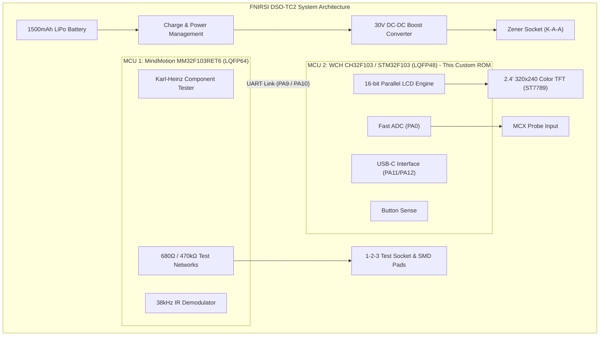
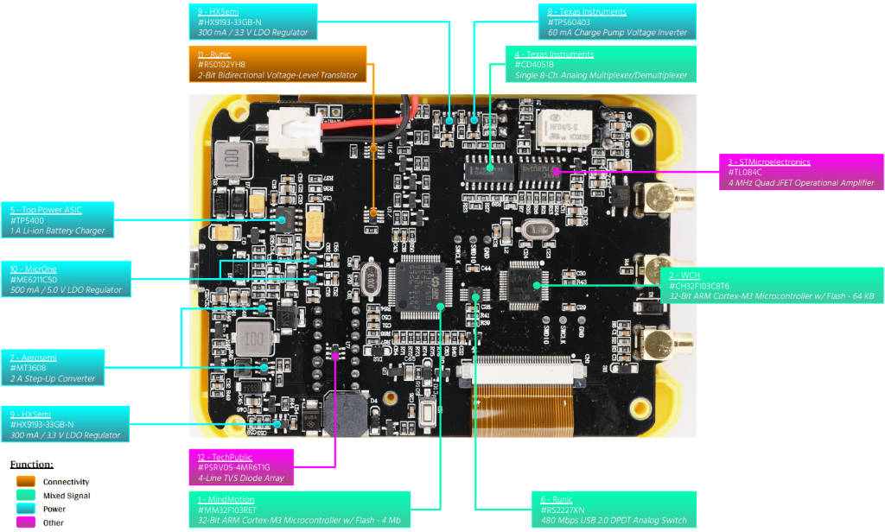

# FNIRSI DSO-TC2 Hardware Architecture & Reverse Engineering Reference

## 1. System Overview

The **FNIRSI DSO-TC2** is a handheld 3-in-1 test instrument combining:
- A digital storage oscilloscope (2.5 MS/s, 200 kHz bandwidth)
- A full-featured component & transistor tester (LCR, ESR, BJT, MOSFET, Diodes)
- A PWM signal / function generator
- A high-voltage Zener diode breakdown tester (up to ~24–30V)
- An IR remote protocol decoder

The device is housed in a compact handheld casing with a 1500 mAh rechargeable lithium-ion battery, a USB-C interface for charging and firmware updates, and a 2.4-inch 320×240 color TFT display.

---

---

## 2. Hardware Architecture & Annotated PCB Teardown

*Figure 2: Complete hardware teardown and component mapping of the FNIRSI DSO-TC2 dual-MCU PCB.*

### Key Integrated Circuit Reference Table

| Ref # | Manufacturer | Part Number | Package | Circuit Function |
| :---: | :--- | :--- | :---: | :--- |
| **1** | MindMotion / ST | **MM32F103RET6 / STM32L083RZT6** | LQFP-64 | **MCU 1**: Component tester, RLC matrix, IR decoder, soft power latch, SigGen (`PB8`) |
| **2** | WCH / ST | **CH32F103C8T6 / STM32F103C6** | LQFP-48 | **MCU 2**: 186 FPS 16-bit parallel TFT graphics engine, oscilloscope fast ADC (`PA0`) |
| **3** | STMicroelectronics | **TL084C** | SOIC-14 | Quad JFET operational amplifier for analog oscilloscope front-end signal conditioning |
| **4** | Texas Instruments | **CD4051B** | SOIC-16 | Single 8-channel analog multiplexer / demultiplexer for Karl-Heinz probe switching |
| **5** | Top Power ASIC | **TP5400** | ESOP-8 | 1A Lithium-Ion battery charger & 5V boost converter management |
| **6** | Runic | **RS2227XN** | MSOP-10 | Dual DPDT 480 Mbps high-speed analog switch |
| **7** | Aerosemi | **MT3608** | SOT23-6 | 2A Step-Up DC-DC Boost Converter (generates ~28V high-voltage rail for Zener tests) |
| **8** | Texas Instruments | **TPS60403** | SOT23-5 | 60 mA charge pump unregulated voltage inverter (generates negative analog rail) |
| **9** | HXSemi | **HX9193-33GB-N** | SOT23-5 | 300 mA / 3.3V ultra-low-noise LDO regulator for digital & analog rails |
| **10** | MicrOne | **ME6211C50** | SOT23-5 | 500 mA / 5.0V high-precision LDO voltage regulator |
| **11** | Runic | **RS0102YH8** | VSSOP-8 | 2-bit bidirectional voltage-level translator for inter-MCU UART link (`PA9`/`PA10`) |
| **12** | TechPublic | **PSRV05-4MR6T1G** | SOT23-6 | 4-line low-capacitance TVS diode array for USB-C & ESD line protection |

---

## 3. Dual-Microcontroller Functional Split

FNIRSI splits the instrument workload between two microcontrollers connected via the Runic RS0102 level translator at 38,400 baud:

### Microcontroller 1: STM32L083RZT6 (LQFP-64) — System & Measurement Engine
*(Replaces original factory MindMotion MM32F103RET6)*
- **Core**: ARM Cortex-M0+ @ 32 MHz, 192 KB Flash, 20 KB SRAM
- **Functions**:
  - High-precision Karl-Heinz Kübbeler & Markus Frejek component & transistor testing engine.
  - Direct connection to the 1-2-3 ZIF socket via precision 680 $\Omega$ and 470 $k\Omega$ resistor networks.
  - Bare-metal Dallas 1-Wire discovery (**DS18B20 / DS18S20 / DS1822**) and single-wire humidity (**DHT11 / DHT22**).
  - Controls the Aerosemi MT3608 boost converter (`PC4`) for 0–30V Zener breakdown testing.
  - Hardware EXTI decoder for 38 kHz infrared remote protocols on `PB9`.
  - 10 Hz – 100 kHz programmable bare-metal `TIM6` signal generator on `PB8`.
  - External SMA DC voltmeter on `PA6` (0–16V range).
  - Li-Po battery voltage divider sense on `PA2`.
  - Active power-hold soft latch on `PB7`.

### Microcontroller 2: STM32F103C6 (LQFP-48) — Display Controller & Oscilloscope Front-End
- **Core**: ARM Cortex-M3 @ 72 MHz, 32 KB Flash, 10 KB SRAM
- **Functions**:
  - Directly drives the 2.4-inch 320×240 TFT LCD via an ultra-fast **16-bit 8080 parallel bus** at **186 FPS**.
  - Acquires analog oscilloscope samples via ADC channel 0 (`PA0`).
  - Manages the USB-C interface (`PA11` / `PA12`).
  - Receives live telemetry from MCU 1 over USART1 (`PA10` RX) @ 38,400 baud.

---

## 3. Display Subsystem (ST7789 2.4" 320×240 TFT)

### 3.1 Bus Interface: 16-bit 8080-II Parallel
The display uses a 16-bit parallel bus for maximum frame rates. Data lines `D0` to `D15` are mapped directly to `PB0` through `PB15` of the MCU. Because `D0` is wired in parallel to both `PA7` and `PB0`, firmware drives both pins synchronously:

| TFT Signal | MCU Pin | Function | Notes |
| :--- | :--- | :--- | :--- |
| **`D0`** | **`PB0` & `PA7`** | Data Bit 0 | Driven synchronously on both ports |
| **`D1`** | **`PB1`** | Data Bit 1 | Direct `GPIOB->ODR` register write |
| **`D2`** | **`PB2`** | Data Bit 2 | Direct `GPIOB->ODR` register write |
| **`D3`** | **`PB3`** | Data Bit 3 | Requires JTAG release (`AFIO_MAPR_SWJ_CFG_JTAGDISABLE`) |
| **`D4`** | **`PB4`** | Data Bit 4 | Requires JTAG release (`AFIO_MAPR_SWJ_CFG_JTAGDISABLE`) |
| **`D5` – `D15`** | **`PB5` – `PB15`** | Data Bits 5–15 | Direct `GPIOB->ODR` register write |
| **`DCX` (RS)** | **`PC13`** | Data / Command Select | LOW = Command, HIGH = Parameter/Pixel Data |
| **`WRX`** | **`PC14`** | Write Strobe Clock | Active LOW; data latched on rising edge |
| **`RDX`** | **`PC15`** | Read Strobe Clock | Held permanently HIGH in output mode |
| **`CSX`** | **`PA15`** | Chip Select | Active LOW |
| **`RESX`** | **`PA8`** | Hardware Reset | Active LOW pulse on initialization |

### 3.2 Critical Display Finding: Normally-White (TN) Panel
The LCD panel on the DSO-TC2 is a **Normally White (TN)** panel, not a Normally Black (IPS) panel:
- **`0x20` (INVOFF)**: Must be used. `0x0000` renders deep pitch black, and `0xFFFF` renders bright white.
- If `0x21` (INVON) is sent, the entire display inverts (black becomes bright white, and text/waveform colors turn inverted blue).

### 3.3 High-Speed Performance Optimization
By utilizing cycle-exact inline assembly write strobes on `PC14` and differential bounding-span column rendering, the custom ROM achieves **186 Frames Per Second (FPS)**.

---

## 4. Power & Programming Notes

### 4.1 Missing SWD Hardware Reset Pin
The SWD header on the DSO-TC2 PCB exposes only 4 pins:
- **`VCC`** (3.3V)
- **`SWDIO`** (`PA13`)
- **`SWCLK`** (`PA14`)
- **`GND`**

Because the hardware **`NRST` pin is NOT connected to the programming header**, standard J-Link or ST-Link hardware resets will fail or timeout.
The firmware and flashing tools must use **`AIRCR.VECTRESET`** (`RSetType 1` in SEGGER J-Link) to perform clean software resets after uploading binaries.
