# FNIRSI DSO-TC2 Complete Dual-MCU Pinout & Hardware Schematic Reference

This document provides the definitive, hardware-verified pinout and schematic architecture for both microcontrollers on the FNIRSI DSO-TC2 Custom ROM:
1. **Tester / System MCU**: `STM32L083RZT6` (ARM Cortex-M0+ @ 32 MHz, LQFP-64) — replaces damaged MindMotion MM32.
2. **Display / Host MCU**: `STM32F103C6` (ARM Cortex-M3 @ 72 MHz, LQFP-48) — drives the 16-bit parallel TFT.

---

## 1. System Interconnection Block Diagram

```mermaid
graph TD
    subgraph PowerSystem ["Power & Peripheral Subsystem"]
        Batt["3.7V 1500mAh LiPo"] --> PwrReg["3.3V Step-Down DC-DC"]
        PwrReg --> MCU_L083
        PwrReg --> MCU_F103
        PwrReg --> Backlight["2.4' LCD Backlight LED"]
        PwrReg --> Buzzer["Piezo Sound Generator"]
        PwrReg --> Relay["Attenuator Switch Relay"]
    end

    subgraph TesterMCU ["MCU 1: STM32L083RZT6 (LQFP-64) - System & Measurement Engine"]
        L083_PwrLatch["PB7: Power Latch (Active HIGH)"]
        L083_BL["PC7: Backlight PWM"]
        L083_Buzz["PC6: Audio Piezo"]
        L083_Relay["PB6: Oscilloscope Relay"]
        L083_IR["PB9: 38kHz IR Demodulator EXTI"]
        
        L083_Keys["Buttons (Active LOW):
        PB13: POWER | PB14: OK (<)
        PB15: MENU  | PC8:  UP (^)
        PC9:  DOWN  | PA8:  TEST (>)"]
        
        L083_Tester["1-2-3 Component Tester Matrix:
        Sense: PA3 (S1), PA4 (S2), PA5 (S3)
        680Ω RL: PA7 (RL1), PB1 (RL2), PB10 (RL3)
        470kΩ RH: PB0 (RH1), PB2 (RH2), PB11 (RH3)"]
        
        L083_TX["PA9: USART1_TX (115200)
        PA2: USART2_TX (115200)"]
    end

    subgraph DisplayMCU ["MCU 2: STM32F103C6 (LQFP-48) - 186 FPS Graphics Host"]
        F103_RX["PA10: USART1_RX (115200)"]
        F103_ADC["PA0: Scope ADC Input"]
        
        F103_LCD_Ctrl["LCD Control:
        PC13: DCX (RS)
        PC14: WRX (Write Strobe)
        PC15: RDX (Tied HIGH)
        PA15: CSX (Chip Select)
        PA8:  RESX (Reset)"]
        
        F103_LCD_Data["16-Bit Parallel Data Bus:
        PB0..PB15 (D0..D15) + PA7 (D0 sync)"]
    end

    subgraph Peripherals ["External Hardware & Sockets"]
        ZIF["1-2-3 ZIF Socket & SMD Pads"]
        LCD["2.4' 320x240 ST7789 Color TFT"]
        IR_Sensor["38kHz Infrared Receiver Diode"]
        BNC["MCX Oscilloscope Probe Jack"]
    end

    L083_PwrLatch -.->|Keep Alive| PwrReg
    L083_BL --> Backlight
    L083_Buzz --> Buzzer
    L083_Relay --> Relay
    IR_Sensor --> L083_IR
    
    L083_Tester <==>|RL / RH / Sense| ZIF
    L083_TX ==>|"Telemetry Link (38,400 baud)"| F103_RX
    
    F103_LCD_Ctrl --> LCD
    F103_LCD_Data ==> LCD
    BNC --> F103_ADC
```



---

## 2. Tester MCU: STM32L083RZT6 (LQFP-64) Pinout

### 2.1 Complete Pinout Table

| LQFP-64 Pin # | Pin Name | Peripheral | Hardware Net / Target | Active Status | Description |
| :---: | :---: | :---: | :---: | :---: | :--- |
| **14** | `PA0` | `ADC_IN0` | MT3608 Zener Divider Tap| **ACTIVE** | High-voltage breakdown voltage sense (0-30V) |
| **16** | `PA2` | `USART2_TX` | Redundant Telemetry Link | **ACTIVE** | Secondary broadcast at 115,200 baud (`RX=NC`) |
| **17** | `PA3` | `ADC_IN3` | Socket Pin 1 Sense | **ACTIVE** | Direct analog voltage measurement tap |
| **20** | `PA4` | `ADC_IN4` | Socket Pin 2 Sense | **ACTIVE** | Direct analog voltage measurement tap |
| **21** | `PA5` | `ADC_IN5` | Socket Pin 3 Sense | **ACTIVE** | Direct analog voltage measurement tap |
| **23** | `PA7` | `GPIO / RL1`| Socket Pin 1 $680\,\Omega$ | **ACTIVE** | Low-range probe resistor ($R_{L1}$) |
| **26** | `PB0` | `GPIO / RH1`| Socket Pin 1 $470\,\text{k}\Omega$ | **ACTIVE** | High-range probe resistor ($R_{H1}$) |
| **27** | `PB1` | `GPIO / RL2`| Socket Pin 2 $680\,\Omega$ | **ACTIVE** | Low-range probe resistor ($R_{L2}$) |
| **28** | `PB2` | `GPIO / RH2`| Socket Pin 2 $470\,\text{k}\Omega$ | **ACTIVE** | High-range probe resistor ($R_{H2}$) |
| **29** | `PB10`| `GPIO / RL3`| Socket Pin 3 $680\,\Omega$ | **ACTIVE** | Low-range probe resistor ($R_{L3}$) |
| **30** | `PB11`| `GPIO / RH3`| Socket Pin 3 $470\,\text{k}\Omega$ | **ACTIVE** | High-range probe resistor ($R_{H3}$) |
| **34** | `PB13`| `GPIO / EXTI`| Button: **POWER** | **ACTIVE** | Active LOW, internal pull-up. Long press = shutdown |
| **35** | `PB14`| `GPIO / EXTI`| Button: **OK** / `<` | **ACTIVE** | Active LOW, navigation & confirmation |
| **36** | `PB15`| `GPIO / EXTI`| Button: **MENU** / `AUTO` | **ACTIVE** | Active LOW, cycles screens & backlight modifier |
| **37** | `PC6` | `GPIO / PWM`| Buzzer / Piezo Audio | **ACTIVE** | DC pulses + multi-tone feedback (1.2 kHz–4.2 kHz) |
| **38** | `PC7` | `GPIO / PWM`| LCD Backlight LED | **ACTIVE** | Brightness dimming (30..255) / On-Off |
| **39** | `PC8` | `GPIO / EXTI`| Button: **UP** / `^` | **ACTIVE** | Active LOW, value increment |
| **40** | `PC9` | `GPIO / EXTI`| Button: **DOWN** / `v` | **ACTIVE** | Active LOW, value decrement |
| **41** | `PA8` | `GPIO / EXTI`| Button: **TEST** / `HOLD` / `>`| **ACTIVE** | Active LOW, triggers component test run |
| **42** | `PA9` | `USART1_TX`| Inter-MCU Primary TX | **ACTIVE** | Transmits telemetry packets to Display MCU @ 115,200 baud |
| **43** | `PA10`| `USART1_RX`| Inter-MCU Primary RX | **ACTIVE** | Receives commands from Display MCU @ 115,200 baud |
| **46** | `PA13`| `SWDIO` | SWD Debug Data | **ACTIVE** | Segger J-Link programming pin |
| **49** | `PA14`| `SWCLK` | SWD Debug Clock | **ACTIVE** | Segger J-Link programming clock |
| **58** | `PB6` | `GPIO` | Oscilloscope Range Relay| **ACTIVE** | Solid-state relay for 1X / 10X input attenuation |
| **59** | `PB7` | `GPIO` | Power-Hold Soft Latch | **ACTIVE** | Driven HIGH on boot to maintain 3.3V power regulator |
| **62** | `PB9` | `GPIO / EXTI`| 38 kHz IR Demodulator | **ACTIVE** | Captures NEC / Samsung / Sony pulse-distance codes |

---

### 2.2 Component Tester Resistor Network Architecture

```
                  STM32L083RZ Pins
               ----------------------
               [ PA7 ] ----/\/\/\----+  (680 Ω RL1)
                            680 Ω    |
               [ PB0 ] ----/\/\/\----+  (470 kΩ RH1)
                            470 kΩ   |
                                     +-----> ZIF Pin 1 (Socket 1)
               [ PA3 ] --------------+  (Direct ADC Channel 3)
                                     
               ----------------------
               [ PB1 ] ----/\/\/\----+  (680 Ω RL2)
                            680 Ω    |
               [ PB2 ] ----/\/\/\----+  (470 kΩ RH2)
                            470 kΩ   |
                                     +-----> ZIF Pin 2 (Socket 2)
               [ PA4 ] --------------+  (Direct ADC Channel 4)
                                     
               ----------------------
               [ PB10] ----/\/\/\----+  (680 Ω RL3)
                            680 Ω    |
               [ PB11] ----/\/\/\----+  (470 kΩ RH3)
                            470 kΩ   |
                                     +-----> ZIF Pin 3 (Socket 3)
               [ PA5 ] --------------+  (Direct ADC Channel 5)
```

---

## 3. Display MCU: STM32F103C6 (LQFP-48) Pinout

### 3.1 Complete Pinout Table

| LQFP-48 Pin # | Pin Name | Default Function | Hardware Net / Connection | Mode / State | Description |
| :---: | :---: | :---: | :---: | :---: | :--- |
| **1** | `VBAT` | Backup Power | Tied to 3.3V digital rail | Power | System VDD |
| **2** | `PC13` | Tamper / RTC | **LCD `DCX` (RS)** | Output | Data / Command Select (LOW=Cmd, HIGH=Data) |
| **3** | `PC14` | OSC32_IN | **LCD `WRX`** | Output | Write Strobe Clock (Inline assembly cycle) |
| **4** | `PC15` | OSC32_OUT | **LCD `RDX`** | Output | Read Strobe (Tied permanently HIGH) |
| **5** | `PD0` | OSC_IN | 8 MHz Crystal Input | Clock | HSE Clock Generator |
| **6** | `PD1` | OSC_OUT | 8 MHz Crystal Output | Clock | HSE Clock Generator |
| **7** | `NRST` | Master Reset | Internal RC (unrouted to SWD) | System | Software reset via AIRCR.VECTRESET |
| **8** | `VSSA` | Analog Ground | System Ground | Power | Clean Analog Ground |
| **9** | `VDDA` | Analog Power | 3.3V Filtered Rail | Power | Clean Analog VDD |
| **10** | `PA0` | `ADC12_IN0` | Scope MCX Analog Front-End | Input | High-speed ADC sampling input |
| **11** | `PA1` | `ADC_IN1 / TIM2` | Signal Generator Output | Reserved | PWM / DAC Waveform Generator |
| **12** | `PA2` | `ADC12_IN2` | Li-Po Battery Voltage Sense | **ACTIVE** | Direct register ADC sampling 2:1 divider (0-4.2V), drives live UI battery gauge & percentage |
| **17** | `PA7` | `GPIO` | **LCD `D0` Parallel Tap** | Output | Synchronously mirrored with `PB0` for bus speed |
| **18** | `PB0` | `GPIO` | **LCD `D0`** | Output | 16-Bit Parallel Data Bit 0 |
| **19** | `PB1` | `GPIO` | **LCD `D1`** | Output | 16-Bit Parallel Data Bit 1 |
| **20** | `PB2` | `BOOT1 / GPIO` | **LCD `D2`** | Output | 16-Bit Parallel Data Bit 2 |
| **21** | `PB10`| `GPIO` | **LCD `D10`** | Output | 16-Bit Parallel Data Bit 10 |
| **22** | `PB11`| `GPIO` | **LCD `D11`** | Output | 16-Bit Parallel Data Bit 11 |
| **25** | `PB12`| `GPIO` | **LCD `D12`** | Output | 16-Bit Parallel Data Bit 12 |
| **26** | `PB13`| `GPIO` | **LCD `D13`** | Output | 16-Bit Parallel Data Bit 13 |
| **27** | `PB14`| `GPIO` | **LCD `D14`** | Output | 16-Bit Parallel Data Bit 14 |
| **28** | `PB15`| `GPIO` | **LCD `D15`** | Output | 16-Bit Parallel Data Bit 15 |
| **29** | `PA8` | `GPIO` | **LCD `RESX`** | Output | Display Hardware Reset (Active LOW pulse) |
| **30** | `PA9` | `USART1_TX` | Inter-MCU Link TX | Output | Telemetry / Command TX @ 38,400 baud |
| **31** | `PA10`| `USART1_RX` | Inter-MCU Link RX | Input | Telemetry RX from L083 Tester @ 38,400 baud |
| **32** | `PA11`| `USB_DM` | USB-C D- Line | USB | Factory Bootloader / VCP |
| **33** | `PA12`| `USB_DP` | USB-C D+ Line | USB | Factory Bootloader / VCP |
| **34** | `PA13`| `JTMS / SWDIO` | DAPLink SWD Data | Debug | OpenOCD programming line |
| **37** | `PA14`| `JTCK / SWCLK` | DAPLink SWD Clock | Debug | OpenOCD programming clock |
| **38** | `PA15`| `GPIO` | **LCD `CSX`** | Output | Display Chip Select (Active LOW) |
| **39** | `PB3` | `GPIO` | **LCD `D3`** | Output | Data Bit 3 (JTAG released via AFIO) |
| **40** | `PB4` | `GPIO` | **LCD `D4`** | Output | Data Bit 4 (JTAG released via AFIO) |
| **41** | `PB5` | `GPIO` | **LCD `D5`** | Output | 16-Bit Parallel Data Bit 5 |
| **42** | `PB6` | `GPIO` | **LCD `D6`** | Output | 16-Bit Parallel Data Bit 6 |
| **43** | `PB7` | `GPIO` | **LCD `D7`** | Output | 16-Bit Parallel Data Bit 7 |
| **44** | `PB8` | `GPIO` | **LCD `D8`** | Output | 16-Bit Parallel Data Bit 8 |
| **45** | `PB9` | `GPIO` | **LCD `D9`** | Output | 16-Bit Parallel Data Bit 9 |
| **46** | `BOOT0`| `Boot Select` | Pulled to GND | Boot | Default flash boot |

---

### 3.2 Graphical 16-Bit Parallel Display Bus Architecture

```
                 STM32F103C6                          ST7789 2.4" TFT (320x240)
              +-----------------+                    +-------------------------+
              |            PA15 |------------------->| CSX   (Chip Select, Act-L)
              |            PC13 |------------------->| DCX   (Cmd: 0 / Data: 1)
              |            PC14 |------------------->| WRX   (Write Clock Strobe)
              |            PC15 |------------------->| RDX   (Read Tied High 3.3V)
              |             PA8 |------------------->| RESX  (Reset Pulse, Act-L)
              |                 |                    |                         |
              |        PB0, PA7 |===================>| D0    (Data Bit 0)      |
              |             PB1 |===================>| D1    (Data Bit 1)      |
              |             PB2 |===================>| D2    (Data Bit 2)      |
              |             PB3 |===================>| D3    (Data Bit 3)      |
              |             PB4 |===================>| D4    (Data Bit 4)      |
              |             PB5 |===================>| D5    (Data Bit 5)      |
              |             PB6 |===================>| D6    (Data Bit 6)      |
              |             PB7 |===================>| D7    (Data Bit 7)      |
              |             PB8 |===================>| D8    (Data Bit 8)      |
              |             PB9 |===================>| D9    (Data Bit 9)      |
              |            PB10 |===================>| D10   (Data Bit 10)     |
              |            PB11 |===================>| D11   (Data Bit 11)     |
              |            PB12 |===================>| D12   (Data Bit 12)     |
              |            PB13 |===================>| D13   (Data Bit 13)     |
              |            PB14 |===================>| D14   (Data Bit 14)     |
              |            PB15 |===================>| D15   (Data Bit 15)     |
              +-----------------+                    +-------------------------+
```

---

## 4. Keypad Pin Assignment & Matrix Map

The front panel buttons connect to the **STM32L083RZ** with internal pull-ups enabled:

```
                  +-----------------------------------+
                  |        FNIRSI DSO-TC2 PANEL       |
                  |                                   |
                  |          [ UP: PC8 ]              |
                  |               ^                   |
                  |   [ < ]               [ > ]       |
                  | [OK: PB14]          [TEST: PA8]   |
                  |               v                   |
                  |         [ DOWN: PC9 ]             |
                  |                                   |
                  |    [MENU: PB15]   [POWER: PB13]   |
                  +-----------------------------------+
```

- **`PB13` (POWER)**: Short click = audio click; hold > 1.5 s triggers soft power-off sequence (`PB7 = LOW`).
- **`PB15` (MENU / AUTO)**: Short click toggles active screen (`Component Tester` $\longleftrightarrow$ `IR Remote Decoder` $\longleftrightarrow$ `Console`).
- **`PB15 + UP / DOWN`**: Controls LCD backlight brightness level (`PC7` PWM).
- **`PB15 + TEST (PA8)`**: Toggles oscilloscope range relay (`PB6`).
- **`PA8` (TEST / HOLD)**: Triggers single-shot component measurement in 1-2-3 socket.
- **`PB9` (IR Receiver)**: Hardware interrupt capture on 38 kHz demodulated remote commands.
